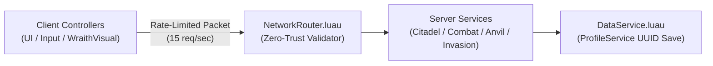

# ARCANE CITADEL — HUMAN DEVELOPER ONBOARDING & ARCHITECTURE GUIDEBOOK
*(Maintained automatically by `@repo-librarian` at Stage 5 so any engineer can understand and extend the codebase in minutes)*

## 1. Quick-Start Onboarding for New Engineers
1. **Install Toolchain:** Run `rokit install && wally install` in the repository root.
2. **Start Live Sync:** Run `rojo serve default.project.json` and click **Connect** in the Roblox Studio Rojo plugin.
3. **Run Local Verification:** Run `bash scripts/verify_luau.sh` to execute anti-deprecation checks (`scan_deprecated_apis.sh`), strict typechecking (`luau-lsp`), linting (`selene`), and `<50ms` headless math tests (`lune`).

## 2. System Dataflow Overview


## 3. Module-by-Module Deep Dive & "How-To-Extend" Cookbooks

### 3.1 Shared Framework — NetworkRouter, StateMachine, ComponentEngine
- **Plain-English Overview:** Every client→server packet flows through `NetworkRouter`, which enforces rate limits and type-checks payloads before any Service sees them. `StateMachine` models multi-step flows (pact lifecycle, breach decisions) as explicit states with guarded transitions. `ComponentEngine` attaches reusable behavior blocks to entities without deep inheritance chains.
- **How to Extend — add a new Network Endpoint:** register it in `NetworkRouter` with direction, rate limit, and payload schema; validate `typeof()`, `NaN` (`x ~= x`), and ownership server-side in the owning Service (`CitadelService`, `CombatService`, `GearAndAnvilService`, `InvasionService`, `MonetizationService`, or `AuctionService`); document it in `docs/API_CONTRACTS.md`.
- **Gotchas:** never trust client timestamps — use `workspace:GetServerTimeNow()`; every listener must survive the `fuzz_network_router` payload battery.

### 3.2 Shared Utility — MultiplierMath, GearScoreMath
- **Plain-English Overview:** `MultiplierMath` is the single source of truth for Blood Pact payout scaling (sanctuary `1.0x`, empty-pact `2.0x` baseline, `2.75x` 2-wall last-stand, idle attackers contribute `0.0x`). `GearScoreMath` converts gear + traits into one comparable power number used by matchmaking and wraith scaling.
- **How to Extend:** add new scaling rules as pure functions here (never inline in Services) so `tests/verify_economy_math.luau` covers them headlessly.
- **Gotchas:** `MultiplierMath` must never return `NaN`/`inf` — fuzz it with zero/negative/huge inputs.

### 3.3 Shared Configurations — WallConfig, WraithConfig, TraitConfig, SpellConfig
- **Plain-English Overview:** Balance lives in data, not code. `WallConfig` holds wall decay (`1.0x → 0.8x → 0.6x`), breach splits, and the `1.5x` elixir auto-renew surcharge. `WraithConfig` tunes the humanoid-free PvE waves. `TraitConfig` holds grimoire roll weights (must sum to 1000). `SpellConfig` defines the Q/E/R kit, cooldowns, and scaling.
- **How to Extend — add a new Weapon or Trait:** append its row to `GearConfig`/`TraitConfig`, keep weights summing to 1000, and mirror reforge costs with the catalog entry in `MonetizationConfig`.
- **Gotchas:** `WallConfig[i].UnlockCost` ≠ `UpgradeCostBase` — different sinks, different scale.

### 3.4 Shared Configurations (Economy & Meta) — MonetizationConfig, ProductConfig, AuctionConfig, AscensionConfig, SabotageConfig, MeshConfig, GraphicsConfig, GearConfig
- **Plain-English Overview:** `MonetizationConfig` is the dual-price catalog guarded by the 1.3x Crown law (`MonetizationConfig.FindUnderValueItems()` must return `{}`). `ProductConfig` holds pasted Robux IDs (`0` = disabled, buttons degrade to "coming soon"). `AuctionConfig` sets escrow fees/durations; `AscensionConfig` sets reset thresholds; `SabotageConfig` prices raider sabotage; `MeshConfig` maps mesh asset IDs; `GraphicsConfig` budgets client effects; `GearConfig` holds base weapon stats.
- **How to Extend — add a new Monetization Product:** add it to `MonetizationConfig` with `RawRobuxPrice / CrownPrice >= 1.3`, paste the ID in `ProductConfig`, wire the grant in `MonetizationService`.
- **Gotchas:** three historical prices drifted below 1.3x (Anvil Reforge x1 at 1.267x, two 149 R$ items at 1.296x) — always re-run the checker after edits.

### 3.5 Server Services (Core Loop) — DataService, GameService, CitadelService, CombatService
- **Plain-English Overview:** `DataService` owns ProfileService UUID saves and routes Souls to `SessionSoulPot` (pact active) vs. `PermanentVaultSouls` (sanctuary). `GameService` owns session lifecycle (plus a Studio DEBUG grant you must delete before launch). `CitadelService` owns walls, elixirs, and `distributeLoot(wallIndex, stolen)` — the ONLY breach funnel, and where `world.lastBreach` (Blood Insurance receipt) is armed. `CombatService` authoritatively resolves spell hits.
- ```mermaid
  sequenceDiagram
      participant UI as CitadelWallDrawer
      participant NR as NetworkRouter
      participant CS as CitadelService
      participant DS as DataService
      UI->>NR: PurchaseElixir {WallIndex}
      NR->>CS: validated payload
      CS->>DS: deduct pot or vault
      DS-->>UI: updated balances
  ```
- **Gotchas:** `distributeLoot` is the single breach funnel — every breach path (decay, wraiths, raider combat) must pass through it.

### 3.6 Server Services (PvE & PvP) — WraithService, InvasionService, GearAndAnvilService
- **Plain-English Overview:** `WraithService` simulates wraiths as server coordinate arrays (no Humanoids) and replicates snapshots for `WraithVisualController` to interpolate. `InvasionService` publishes raid targets via `MemoryStoreSortedMap` and enforces the 90s anti-combat-log. `GearAndAnvilService` owns loadouts, grimoire rolls, anvil reforging, and 5-life gear fracture.
- **How to Extend — add a new Wraith type:** add its row to `WraithConfig`, spawn it from `WraithService`, and add its visual in `WraithVisualController`.
- **Gotchas:** `WraithService` arrays are the server truth; clients only ever render.

### 3.7 Server Services (World & Meta) — WorldBuilder, MeshLoader, CharacterDresser, MonetizationService, AuctionService
- **Plain-English Overview:** `WorldBuilder` validates/repairs runtime citadel geometry against `WallConfig`. `MeshLoader` resolves `rbxassetid://` URIs from `assets/asset_manifest.json` (populated by `/forging-3d-asset`). `CharacterDresser` applies cosmetic loadout visuals. `MonetizationService` handles dual-checkout grants and `ProcessReceipt`. `AuctionService` settles Phase-2 escrow listings and bids.
- **Gotchas:** `MeshLoader` must tolerate missing manifest entries (empty `{}` state) without erroring.

### 3.8 Client Controllers — CombatInputController, WraithVisualController, EconomyClient, CameraController, SoundController
- **Plain-English Overview:** `CombatInputController` owns ALL Q/E/R cooldown timers so hotkeys and `SpellBar` buttons share one timer and cannot bypass each other. `WraithVisualController` lerps wraith meshes between server snapshots. `EconomyClient` is the only correct way to read inventory (`EconomyClient.GetInventoryCached()` — never raw per-frame `InvokeServer`). `CameraController` runs the siege rig; `SoundController` runs the SFX/music bus.
- **Gotchas:** cooldowns live in `CombatInputController` alone — do not duplicate timers in UI.

### 3.9 Client UI — UITheme, TopEconomyHUD, CitadelWallDrawer, BreachDecisionModal
- **Plain-English Overview:** `UITheme` is the shared Dark Witchery palette/fonts/spacing — every screen imports it. `TopEconomyHUD` shows pot/vault balances and the pact toggle. `CitadelWallDrawer` handles wall upgrades, elixir purchase, and auto-renew toggles. `BreachDecisionModal` offers accept-defeat (bank 67%) vs. hold-line vs. Blood Insurance.
- **How to Extend — add a new Network Endpoint button:** tag it `UIActionButton` with an `Action` attribute (see `audit_or_wireframe_ui.luau`), handle it through `NetworkRouter`, and add its row to `docs/API_CONTRACTS.md`.

### 3.10 Client UI — GlobalRaidBrowser, GrimoireAndAnvilModal, CombatAndInvaderHUD, InvaderHUD, SpellBar
- **Plain-English Overview:** `GlobalRaidBrowser` lists cross-server targets from `InvasionService`. `GrimoireAndAnvilModal` covers rolls, auto-roll, reforge, fracture repair, and loadout swap. `CombatAndInvaderHUD` is the legacy combined overlay, now split into `InvaderHUD` (raider overlay) and `SpellBar` (cast buttons bound to `CombatInputController` timers).
- **Gotchas:** `CombatAndInvaderHUD` is superseded by `InvaderHUD` + `SpellBar` — do not add new features to the legacy file.

### 3.11 Client UI (Meta & Support) — AuctionBoardModal, ShopModal, PlaytimeGiftGridModal, FifthDeathModal, NoticeBanner, HelpPanel
- **Plain-English Overview:** `AuctionBoardModal` fronts `AuctionService` escrow; `ShopModal` fronts the `MonetizationService` dual-checkout storefront; `PlaytimeGiftGridModal` claims 10m/30m/60m gifts; `FifthDeathModal` shows fifth-death panic offers; `NoticeBanner` shows system toasts; `HelpPanel` is onboarding/control reference.
- **Gotchas:** until Robux IDs are pasted in `ProductConfig`, every BUY button must explain the shop is coming soon and charge nothing.
